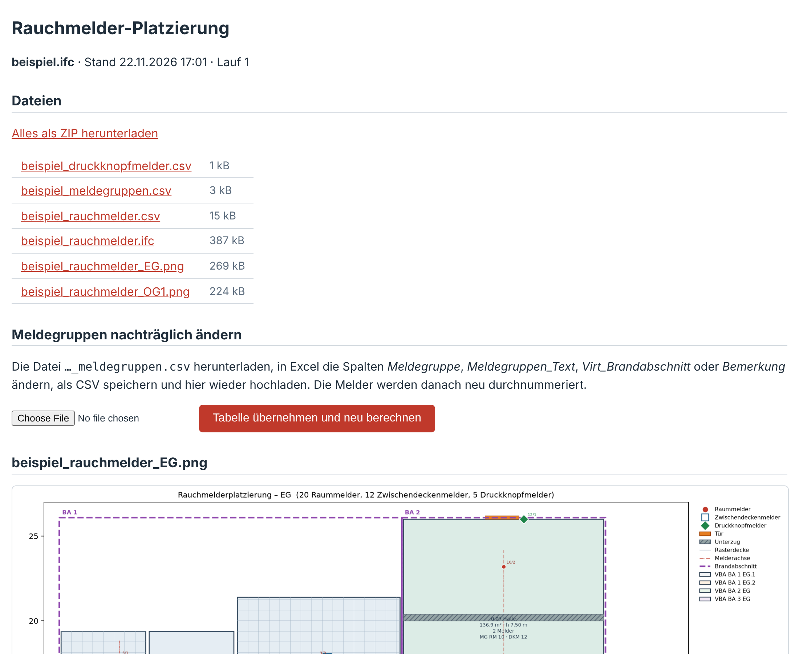

# Betrieb auf einem Hostinger-VPS

Die Rauchmelder-Platzierung läuft als Webanwendung in zwei Docker-Containern:

- **app** – das Programm mit Weboberfläche (`webapp.py`, Python/Flask/gunicorn)
- **caddy** – nimmt die Anfragen an und besorgt das HTTPS-Zertifikat automatisch

Das normale Hostinger-Webhosting (PHP) reicht nicht aus: Die IFC-Bibliothek
`ifcopenshell` braucht einen Server mit eigener Python-Umgebung, also einen **VPS**.



## Voraussetzungen

- Hostinger-VPS mit Ubuntu oder Debian (x86-64), empfohlen ab 2 vCPU / 4 GB RAM –
  große IFC-Modelle brauchen Arbeitsspeicher
- SSH-Zugang als `root` (IP-Adresse und Zugangsdaten stehen im Hostinger-Panel)
- für HTTPS: eine (Sub-)Domain, deren DNS-A-Record auf die IP des VPS zeigt,
  z. B. `melder.meinefirma.de`
- in der Firewall des VPS die Ports **80** und **443** freigeben

## Einrichtung

```bash
# 1. Auf dem VPS anmelden
ssh root@<IP-des-VPS>

# 2. Docker installieren (entfällt, wenn der VPS mit einer Docker-Vorlage erstellt wurde)
curl -fsSL https://get.docker.com | sh

# 3. Programm holen
git clone -b claude/awesome-keller-u1xbnq https://github.com/sekorff/Dynamo.git
cd "Dynamo/Smoke Detector Placement"

# 4. Einstellungen anlegen
cp .env.beispiel .env
nano .env          # DOMAIN und APP_PASSWORT eintragen

# 5. Bauen und starten
docker compose up -d --build
```

Danach ist die Anwendung unter `https://<DOMAIN>` erreichbar. Der Browser fragt
nach Benutzername (`APP_BENUTZER`, Standard `planer`) und Passwort (`APP_PASSWORT`).

Ist das Repository privat, verlangt `git clone` eine Anmeldung bei GitHub
(Benutzername und persönliches Zugriffstoken). Alternativ den Ordner
`Smoke Detector Placement` vom eigenen Rechner hochladen:

```bash
scp -r "Smoke Detector Placement" root@<IP-des-VPS>:/root/rauchmelder
```

## Einstellungen (`.env`)

| Variable | Bedeutung |
|---|---|
| `DOMAIN` | Adresse der Anwendung. Mit einer Domain richtet Caddy HTTPS selbst ein. `:80` nur zum Testen ohne Domain – dann unverschlüsselt über `http://<IP>` |
| `APP_BENUTZER`, `APP_PASSWORT` | Anmeldung. Ohne Passwort startet die Anwendung nicht |
| `MAX_UPLOAD_MB` | größte IFC-Datei (Standard 500 MB) |
| `AUFBEWAHRUNG_TAGE` | Aufträge werden nach so vielen Tagen gelöscht (Standard 14) |

Ohne Domain (`DOMAIN=:80`) gehen Passwort und Modelle unverschlüsselt über das
Netz – nur für einen kurzen Test verwenden.

## Bedienung

1. IFC-Datei hochladen, Parameter prüfen, **Berechnen**.
2. Ergebnis ansehen: Pläne je Geschoss, Bericht, Dateien einzeln oder als ZIP.
3. Meldegruppen ändern: `…_meldegruppen.csv` herunterladen, in Excel bearbeiten,
   auf der Ergebnisseite wieder hochladen – es wird neu gerechnet und die Melder
   werden neu durchnummeriert.

Die Weboberfläche bietet die wichtigsten Parameter an. Alle übrigen (siehe
`README.md`) laufen mit ihren Standardwerten; für Sonderfälle lässt sich das
Programm weiterhin direkt aufrufen:

```bash
docker compose exec app python rauchmelder_platzierung.py --help
```

## Betrieb

```bash
docker compose ps                 # Zustand
docker compose logs -f app        # Protokoll
docker compose restart            # Neustart
git pull && docker compose up -d --build    # Aktualisieren
docker compose down               # Stoppen (Daten bleiben erhalten)
```

Hochgeladene Modelle und Ergebnisse liegen im Docker-Volume `daten` und
überstehen Neustarts und Aktualisierungen. `docker compose down -v` löscht sie.

## Hinweise

- Eine Berechnung läuft, solange die Seite lädt (Abbruch nach 30 Minuten).
  Es rechnen höchstens zwei Aufträge gleichzeitig.
- Die Anmeldung ist ein gemeinsames Passwort für alle Nutzer; jeder Angemeldete
  sieht alle Aufträge. Für getrennte Nutzerkonten wäre eine Erweiterung nötig.
- Die hochgeladenen IFC-Modelle liegen auf dem VPS. Wer dort Zugriff hat, kann
  sie lesen – Passwort und SSH-Zugang entsprechend schützen.
