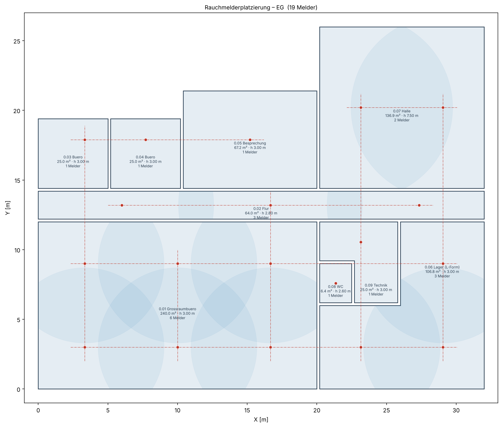

# Rauchmelder-Platzierung aus IFC

Platziert punktförmige Rauchmelder automatisch in allen Räumen einer IFC-Datei.
Grundlage sind die Raumvolumen (`IfcSpace`). Die Melder werden je Raum in einem
regelmäßigen Raster gesetzt und raumübergreifend auf gemeinsame Achsen gelegt.



## Installation

```
pip install -r requirements.txt
```

## Aufruf

```
python rauchmelder_platzierung.py modell.ifc                 # CSV + PNG-Plan je Geschoss
python rauchmelder_platzierung.py modell.ifc --ifc-ausgabe   # zusätzlich IFC mit Meldern
python rauchmelder_platzierung.py modell.ifc --raster 0.625  # auf Deckenraster fangen
python rauchmelder_platzierung.py --help                     # alle Parameter
```

Zum Ausprobieren erzeugt `python beispiel_ifc_erzeugen.py beispiel.ifc` ein Testmodell.

Ausgaben (neben der IFC-Datei oder im Ordner `-o`):

| Datei | Inhalt |
|---|---|
| `*_rauchmelder.csv` | je Melder: Geschoss, Raum, Bezeichnung, X/Y/Z in m (Z = Raumoberkante), A, DH, Hinweise |
| `*_rauchmelder_<Geschoss>.png` | Grundriss mit Meldern, Überwachungsradien und Achsen |
| `*_rauchmelder.ifc` | Ursprungsmodell plus Melder als `IfcSensor` (`SMOKESENSOR`), dem Geschoss zugeordnet |

## Verfahren

1. **Raumgeometrie** – Das Volumen jedes `IfcSpace` wird in die XY-Ebene projiziert
   (Grundriss); die Raumhöhe ergibt sich aus der Z-Ausdehnung.
2. **Projektierungswerte** – Aus Grundfläche und Höhe folgen die maximale
   Überwachungsfläche A je Melder und der maximale Horizontalabstand DH:

   | Grundfläche | Raumhöhe | A | DH |
   |---|---|---|---|
   | ≤ 80 m² | ≤ 12 m | 80 m² | 6,6 m |
   | > 80 m² | ≤ 6 m | 60 m² | 5,7 m |
   | > 80 m² | 6 – 12 m | 80 m² | 6,6 m |

   Gänge schmaler als 3 m: Melderabstand bis 15 m (7,5 m zum Gangende).
   Wandabstand mindestens 0,5 m. Räume über 12 m Höhe werden mit Hinweis markiert.
3. **Raster** – Parallel zur dominanten Wandrichtung des Raums wird das kleinste
   Raster (Reihen × Spalten) gesucht, bei dem kein Punkt des Raums weiter als DH
   vom nächsten Melder entfernt ist und die Melderzahl ≥ Fläche / A ist.
   Rasterpunkte außerhalb verwinkelter Räume entfallen.
4. **Achsen** – Die Räume werden von groß nach klein bearbeitet. Jedes Raumraster
   wird um höchstens `--max-verschiebung` (Standard 1,5 m) auf bereits vorhandene
   Achsen bzw. das Deckenraster geschoben – nur wenn danach weiterhin alle Regeln
   eingehalten sind. Die Achsen gelten über alle Geschosse.

## Grenzen

- Die Normwerte sind Voreinstellungen für flache Decken (Neigung ≤ 20°) und per
  Parameter änderbar. **Sie ersetzen keine Fachplanung** und sind gegen die gültige
  DIN VDE 0833-2 / VdS 2095 und das Brandschutzkonzept zu prüfen.
- Nicht berücksichtigt: Unterzüge und Deckenfelder, Dachneigung, Zwischendecken und
  Doppelböden, Einbauten, Lüftungsauslässe, Leuchten sowie die Raumnutzung
  (z. B. Nassräume ohne Melder – dafür `--min-flaeche` oder Nachbearbeitung der CSV).
- Die Abstandsprüfung rechnet Luftlinie innerhalb des Raums.
