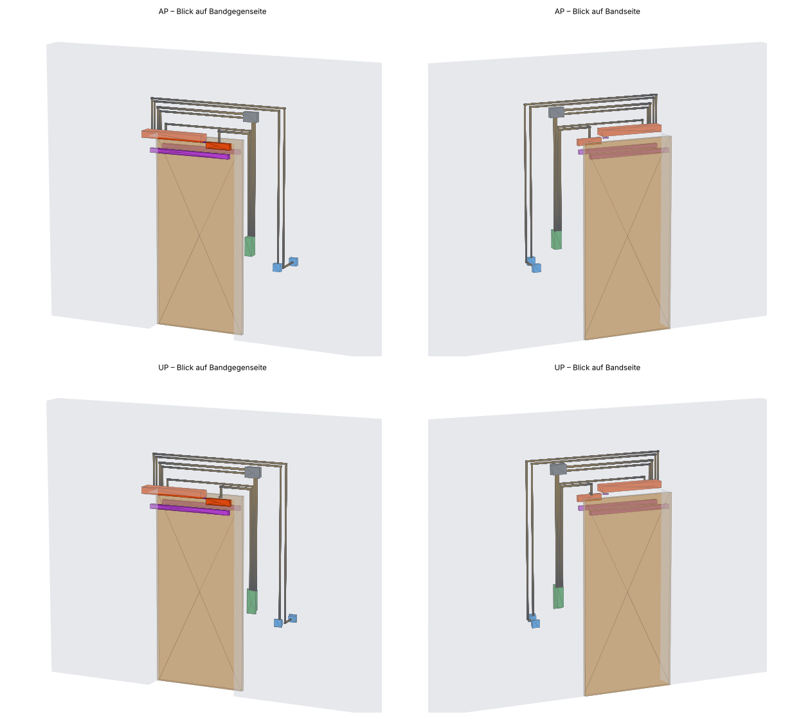

# Türsteuerung platzieren

Setzt für ausgewählte Türen eines IFC-Modells die Bauteile der Türsteuerung als Quader mit ihren Außenmaßen, weist IFC-Klasse und Typ zu und verbindet sie mit Leerrohren. Es gibt eine Aufputz- und eine Unterputz-Variante. Vor dem Setzen prüft das Skript den Platz an der Schlossseite und weicht bei Bedarf auf die Querwand aus.

Grundlage ist das Ausführungsschema: Drehtürantrieb dormakaba ED 100/250, Türzentrale GEZE TZ 320 BSN, Haftmagnet GEZE MA 500.



## Dateien

| Datei | Inhalt |
|---|---|
| `platzierung.json` | Die Platzierungsanweisung: Bauteile, Maße, IFC-Klassen, Positionen, Leerrohre |
| `tuersteuerung_platzieren.py` | Wendet die Anweisung auf Türen eines IFC-Modells an |
| `testmodell_erzeugen.py` | Baut das Testmodell und beide Varianten |
| `testmodell_pruefen.py` | Prüft die erzeugten Modelle gegen die Anweisung |
| `testmodell.ifc` | Testmodell ohne Bestückung |
| `testmodell_AP.ifc`, `testmodell_UP.ifc` | Aufputz und Unterputz, Bedienelemente einseitig |
| `testmodell_AP_beidseitig.ifc`, `testmodell_UP_beidseitig.ifc` | Aufputz und Unterputz, Bedienelemente beidseitig |

## Auslösen

Voraussetzung: Python 3 und `pip install ifcopenshell`. Das Modell muss IFC4 oder IFC4X3 sein.

```
python tuersteuerung_platzieren.py modell.ifc -o modell_AP.ifc --variante AP
python tuersteuerung_platzieren.py modell.ifc -o modell_UP.ifc --variante UP
python tuersteuerung_platzieren.py modell.ifc -o modell_AP2.ifc --variante AP --bedienung beidseitig
```

`--bedienung` wählt die Anordnung der Bedienelemente: `einseitig` (Standard) oder `beidseitig`. Eine einzelne Tür lässt sich über das Merkmal `Tuersteuerung.Bedienung` abweichend festlegen.

Welche Türen bestückt werden:

| Angabe | Wirkung |
|---|---|
| keine | Türen mit dem Merkmal `Tuersteuerung.Fluchttuersteuerung = TRUE` |
| `--tuer <GlobalId>` | genau diese Tür, mehrfach möglich |
| `--name "T0[12]"` | Türen, deren Name auf den regulären Ausdruck passt |
| `--alle` | alle Türen |

Ein zweiter Lauf auf dieselbe Tür ersetzt die frühere Bestückung. So lässt sich eine Tür von AP auf UP umstellen.

Je Tür meldet das Skript, wo die Bedienelemente sitzen. Lässt sich die Regel an einer Tür nicht umsetzen, wird sie mit Begründung ausgelassen und das Modell dort nicht verändert.

## Bauteile

| BMK | Bauteil | B × H × T in mm | IFC-Klasse | PredefinedType | Maße aus |
|---|---|---|---|---|---|
| -A2 | Drehtürantrieb ED 100/250 | 685 × 70 × 130 | IfcActuator | ELECTRICACTUATOR | dormakaba Montageanleitung |
| -A1 | Türzentrale TZ 320 BSN | AP 77 × 197 × 88, UP 98 × 260 × 11,5 | IfcUnitaryControlElement | CONTROLPANEL | GEZE Produktdatenblätter |
| -A3 | Terminal T 320, nur bei beidseitig | wie -A1 | IfcUnitaryControlElement | CONTROLPANEL | Annahme |
| -Y1 | Haftmagnet MA 500 | 265 × 66 × 41 | IfcActuator | USERDEFINED „HAFTMAGNET“ | GEZE Produktdatenblatt |
| -S1, -S2 | Taster innen, außen | AP 80 × 80 × 45, UP 80 × 80 × 12 | IfcSwitchingDevice | MOMENTARYSWITCH | Annahme |
| -S5 | Türkontakt | 60 × 13 × 13 | IfcSensor | CONTACTSENSOR | Annahme |
| -B1, -B2 | Sicherheitssensoren | (Türbreite − 100) × 45 × 40 | IfcSensor | MOVEMENTSENSOR | Annahme |
| -X1 | Übergabedose zur Trasse | AP 150 × 100 × 60, UP 160 × 110 × 3 | IfcJunctionBox | POWER | Annahme |
| R1–R8 | Leerrohre M16 / M20 | Außendurchmesser 16 / 20 | IfcCableCarrierSegment | CONDUITSEGMENT | Nenngröße |
| R1–R8 | Bögen 90°, Innenradius 100 | Außendurchmesser 16 / 20 | IfcCableCarrierFitting | BEND | Vorgabe |

IFC kennt keine eigene Klasse für Haftmagnete. `IfcActuator` mit `USERDEFINED` ist die nächstliegende Wahl.

Jedes Bauteil bekommt ein Typobjekt (z. B. `IfcActuatorType`), das Merkmalset `Tuersteuerung` (BMK, Variante, Tür, Maße, Quelle der Maße) und gehört zu einem `IfcDistributionSystem` je Tür.

## Lage an der Tür

Bezug ist die Tür selbst: `s` läuft ab der Bandkante entlang der Wand zur Schlossseite, `z` ab Unterkante Tür. Die Regel spiegelt sich bei Band rechts von selbst. Die Bandseite ist die Seite, zu der die Tür öffnet (IFC: +y der Tür). Die Wanddicke liest das Skript aus der Öffnung.

- **Bandgegenseite (Fluchtseite):** Antrieb über der Tür ab Bandkante, Haftmagnet und Türkontakt oben an der Schlossseite, Türzentrale, Taster innen, Übergabedose über der Türzentrale.
- **Bandseite:** Taster außen, Sicherheitssensor.

### Bedienelemente

Bedienelemente sind Türzentrale (-A1), Taster innen (-S1), Taster außen (-S2) und bei beidseitiger Anordnung das Terminal (-A3).

- **Einseitig:** Türzentrale und Taster innen auf der Bandgegenseite, Taster außen auf der Bandseite.
- **Beidseitig:** zusätzlich ein Terminal mit Nottaste auf der Bandseite, der Türzentrale gegenüber. So lässt sich die Tür aus beiden Richtungen freischalten.

- **Höhe:** Die Oberkante liegt zwingend auf +1,05 m über Unterkante Tür. Bei Unterputz zählt die Oberkante der Frontplatte.
- **Platzprüfung:** Vor dem Setzen misst das Skript an der Schlossseite die freie Wandlänge ab Türrahmen. Als Hindernis zählen Querwände und Stützen vor der Wandfläche, das Ende der Türwand und andere Öffnungen in der Türwand. Geprüft wird im Höhenband 0,80 bis 1,10 m.
- **Mindestens 1,2 m frei:** Türzentrale 200 mm neben dem Rahmen, Taster innen weitere 300 mm daneben.
- **Weniger als 1,2 m frei:** Die Bedienelemente der Bandgegenseite kommen auf die Querwand, also um 90° gedreht, mit der Türzentrale 2,2 m von der Türwand entfernt. Der Taster innen sitzt 300 mm weiter, die Übergabedose wandert mit. Die Leerrohre laufen um die Raumecke.
- **Weniger als 1,2 m frei und keine Querwand:** Die Tür wird nicht bestückt und gemeldet.
- **Bandseite:** Dieselbe Prüfung läuft für den Taster außen. Fehlt dort der Platz, werden die Bedienelemente der Bandseite und ihre Leerrohre nicht gesetzt und gemeldet. Ein Ausweichen auf eine Querwand gibt es auf der Bandseite noch nicht.

Die 2,2 m sind ab der Wandfläche der Türwand entlang der Querwand gemessen, bis zur Mitte der Türzentrale. Alle Werte stehen unter `bedienelemente` in `platzierung.json`.

## Leerrohre

| Rohr | Größe | Von → Nach | Kabel |
|---|---|---|---|
| R1 | M20 | -A2 → -X1 | -W1 (230 V Antrieb) |
| R2 | M16 | -A2 → -X1 | -W12 (GLT Antrieb) |
| R3 | M20 | -A1 → -X1 | -W2 (230 V Türzentrale) |
| R4 | M20 | -A1 → -X1 | -W3, -W11 (BMA, GLT Türzentrale) |
| R5 | M20 | -A2 → -A1 | -W6 (Kurzzeitentriegelung), bei beidseitig auch -W13 |
| R6 | M20 | -Y1 → -A1 | -W4, -W5 (Magnet, Türkontakt) |
| R7 | M16 | -A2 → -S1 | -W7 (Taster innen) |
| R8 | M16 | -A2 → -S2 | -W8 (Taster außen, mit Wanddurchführung) |
| R9 | M20 | -A2 → -A3 | -W13 (Terminal Bandseite, nur bei beidseitig, mit Wanddurchführung) |

- **Bögen:** Jeder Richtungswechsel ist ein 90°-Bogen mit 100 mm Innenradius (`IfcCableCarrierFitting`, `BEND`). Gerade Stücke und Bögen schließen lückenlos aneinander an. Ist ein Abschnitt für die Bögen zu kurz, wird die Tür nicht bestückt und gemeldet.
- **Aufputz:** Rohre liegen auf der Wandfläche der Bandgegenseite und enden an den Gehäusen.
- **Unterputz:** Rohrachse 35 mm tief in der Wand. Türzentrale, Taster und Übergabedose bekommen zusätzlich einen Einbaukörper in der Wand. An Aufputzgeräten (Antrieb, Magnet) endet das Rohr als Wandauslass hinter dem Gerät. Türwände unter 135 mm werden nicht bestückt.
- **Bandseite (R8, R9):** Die Rohre gehen hinter dem Antrieb durch die Wand und laufen auf der Bandseite zu Taster und Terminal. Das Kabel -W13 des Terminals läuft vom Antrieb im Rohr R5 weiter zur Türzentrale. Bei Aufputz liegt der Bogen der Wanddurchführung im Wandquerschnitt und braucht dort eine Aussparung.

Die Rohre sind so geordnet, dass sie sich nicht kreuzen. Jedes Stück ist über `IfcRelConnectsElements` mit seinem Nachbarn und den beiden Endgeräten verbunden. 230 V und Signalkabel liegen in getrennten Rohren.

Ohne Leerrohr: die Sensorleitungen -W9/-W10 (Kabelübergang am Türblatt) und die Weiterführung ab der Übergabedose zur Trasse.

## Testmodell

```
python testmodell_erzeugen.py
python testmodell_pruefen.py
```

Das Testmodell hat drei Wände und fünf Türen:

| Tür | Situation | Ergebnis |
|---|---|---|
| T01 | Band links, Wand 240 mm, 1400 mm frei bis zur Querwand | Bedienelemente neben der Tür |
| T02 | Band rechts, Wand 175 mm, um 90° gedreht | Bedienelemente neben der Tür |
| T03 | ohne Auslöser-Merkmal | bleibt unbestückt |
| T04 | Band rechts, 325 mm bis zur Querwand | Bedienelemente auf der Querwand, 2,2 m von der Türwand |
| T05 | 400 mm bis zum Wandende, keine Querwand | wird abgelehnt und gemeldet |

Alle vier Kombinationen aus Aufputz/Unterputz und einseitig/beidseitig werden erzeugt und geprüft. Die Prüfung kontrolliert Vollständigkeit, IFC-Klassen und Typen, Außenmaße, die Oberkante der Bedienelemente, die Lage auf der Querwand, Innenradius und lückenlosen Anschluss der Bögen, Lage der Rohre zur Wand, Achsabstände zwischen den Rohren, Durchdringungen und die durchgehende Verbindung jedes Leerrohrs.

## Grenzen

- Das Terminal -A3 ist als GEZE T 320 angenommen, mit dem Gehäuse der TZ 320. Gerät, Maße und Kabel -W13 sind beim Hersteller zu bestätigen und stehen noch nicht im Ausführungsschema.

- Die Körper sind Quader mit den Außenmaßen, keine Herstellergeometrie.
- Maße mit Quelle „Annahme“ gehören zu Bauteilen ohne festgelegtes Fabrikat.
- Die Sicherheitssensoren sitzen am Türblatt. Sie sind vor den Wandflächen platziert, nicht auf der tatsächlichen Blattebene.
- Über der Tür braucht die Regel 430 mm freie Wand. Das prüft das Skript nicht.
- Die Platzprüfung arbeitet mit den Hüllquadern der Bauteile im Koordinatensystem der Tür. Bei schräg stehenden Wänden ist sie ungenau.
- Auf der Querwand selbst wird nicht geprüft, ob dort Öffnungen oder Einbauten liegen.
- Liegt der Türrahmen weniger als etwa 60 mm vor der Raumecke, passen die Bögen nicht. Die Tür wird dann abgelehnt.
- Die Regel geht davon aus, dass der Ursprung der Tür auf Höhe Fertigfußboden liegt.
